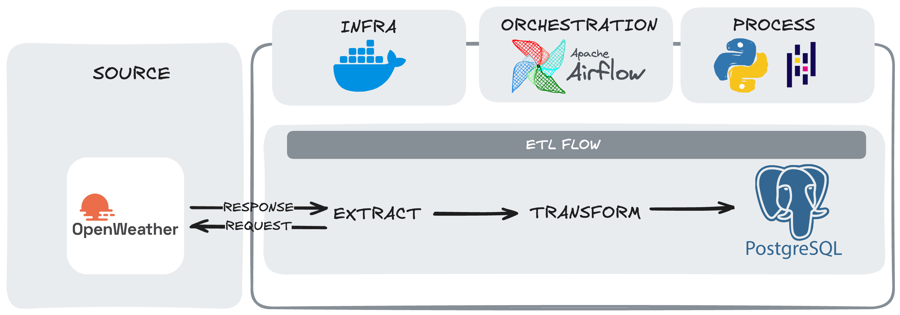

<div align="center">
  <h1>🌦️ Weather Pipeline</h1>
  <p><em>Pipeline ETL de dados climáticos de São Paulo, orquestrado com Apache Airflow</em></p>
  <p>
    
    
    
    
    
  </p>
</div>

---

## 📝 Sobre

Pipeline **ETL** que roda a cada hora e:

1. **Extrai** o clima atual de São Paulo da API do [OpenWeatherMap](https://openweathermap.org/api);
2. **Transforma** o JSON com Pandas: normaliza campos aninhados, remove e renomeia colunas, converte datas para `America/Sao_Paulo`;
3. **Carrega** o resultado em um **PostgreSQL**, montando um histórico na tabela `sp_weather`.

A orquestração fica com o **Airflow 3**, que cuida de agendamento, retentativas e monitoramento. Toda a infraestrutura sobe com `docker compose`.

---

## 🏛️ Arquitetura



| Serviço | Função | Porta |
| --- | --- | --- |
| `airflow-apiserver` | Interface web do Airflow | `8080` |
| `airflow-scheduler`, `worker`, `dag-processor`, `triggerer` | Execução e agendamento da DAG | — |
| `warehouse` | PostgreSQL com os dados do pipeline | `5433` |
| `postgres` / `redis` | Metadados do Airflow / fila do Celery | — |

> O banco dos dados (`warehouse`) é separado do banco de metadados do Airflow (`postgres`), como em um ambiente de produção.

---

## 🛠️ Tecnologias

| Componente | Tecnologias |
| --- | --- |
| **Orquestração** | Apache Airflow 3.1 (Task SDK, CeleryExecutor) |
| **Processamento** | Python 3.12, Pandas, PyArrow |
| **Armazenamento** | PostgreSQL 16, SQLAlchemy |
| **Infraestrutura** | Docker Compose, Redis |

---

## 📂 Estrutura

```
weather-pipeline/
├── dags/weather_dag.py           # DAG: extract >> transform >> load
├── src/weather_pipeline/
│   ├── extract_data.py           # Requisição à API e gravação do JSON
│   ├── transform_data.py         # Limpeza e normalização com Pandas
│   └── load_data.py              # Carga no PostgreSQL
├── config/.env.example           # API_KEY e credenciais do banco
├── docs/arquitetura.png
├── notebooks/                    # Exploração inicial dos dados
├── .env.example                  # AIRFLOW_UID
└── docker-compose.yaml
```

---

## 🚀 Como Rodar

**Pré-requisitos:** Docker com Docker Compose e uma [chave gratuita da OpenWeatherMap](https://home.openweathermap.org/api_keys).

**1. Clone o repositório**

```bash
git clone <url-do-repositorio>
cd weather-pipeline
```

**2. Configure as variáveis de ambiente**

```bash
cp .env.example .env
cp config/.env.example config/.env
```

- Em `.env`, coloque em `AIRFLOW_UID` a saída do comando `id -u`.
- Em `config/.env`, preencha sua `API_KEY` e defina uma senha em `DB_PASSWORD`.

**3. Suba os containers**

```bash
mkdir -p logs plugins data
docker compose up -d
```

Na primeira vez, o `airflow-init` leva cerca de 1 minuto. Para acompanhar, use `docker compose ps`; todos os serviços devem ficar `healthy`.

---

## 💡 Como Usar

1. Acesse **http://localhost:8080** (usuário `airflow`, senha `airflow`).
2. Ative a DAG **`weather_pipeline`** para rodar de hora em hora, ou clique em **▶ Trigger** para rodar agora.

Para rodar uma vez pelo terminal:

```bash
docker compose exec airflow-scheduler airflow dags test weather_pipeline
```

Para consultar os dados, conecte um cliente SQL em `localhost:5433` com as credenciais do `config/.env`, ou rode:

```bash
docker compose exec warehouse sh -c 'psql -U "$DB_USER" -d "$DB_NAME" -c "SELECT city_name, temperature, humidity, datetime FROM sp_weather ORDER BY datetime DESC LIMIT 10;"'
```

> ⚠️ `docker compose down -v` apaga os volumes, e com eles o histórico da tabela.

---

## 🔧 Melhorias em Relação ao Tutorial

O projeto partiu de um [tutorial em vídeo](https://youtu.be/I8qPqbXQBDU) e foi atualizado para as versões atuais das ferramentas:

- **Airflow 3:** migração de `airflow.decorators` para o Task SDK (`airflow.sdk`).
- **Banco no Docker:** novo serviço `warehouse`, sem depender de um Postgres instalado na máquina.
- **Bugs corrigidos:** colunas que não eram renomeadas, dependências entre tasks sem `()`, caminhos relativos frágeis e um import incorreto (`from ast import List`) que quebrava a DAG.
- **Tipagem:** conexão montada com `sqlalchemy.URL`, validação das variáveis de ambiente e anotações corrigidas, sem erros no basedpyright.

---

## 👤 Autor

Desenvolvido por **João Victor Soave** como projeto de portfólio em Engenharia de Dados.
